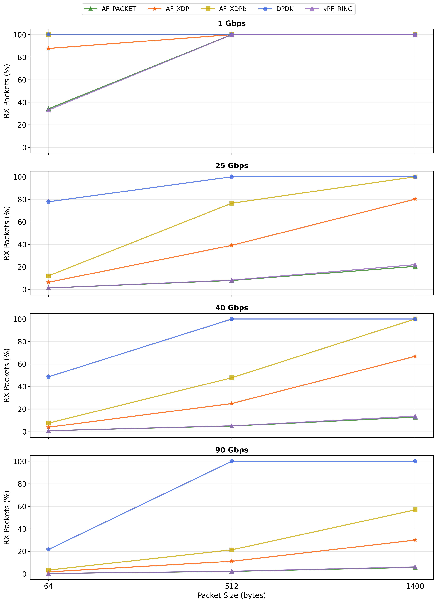
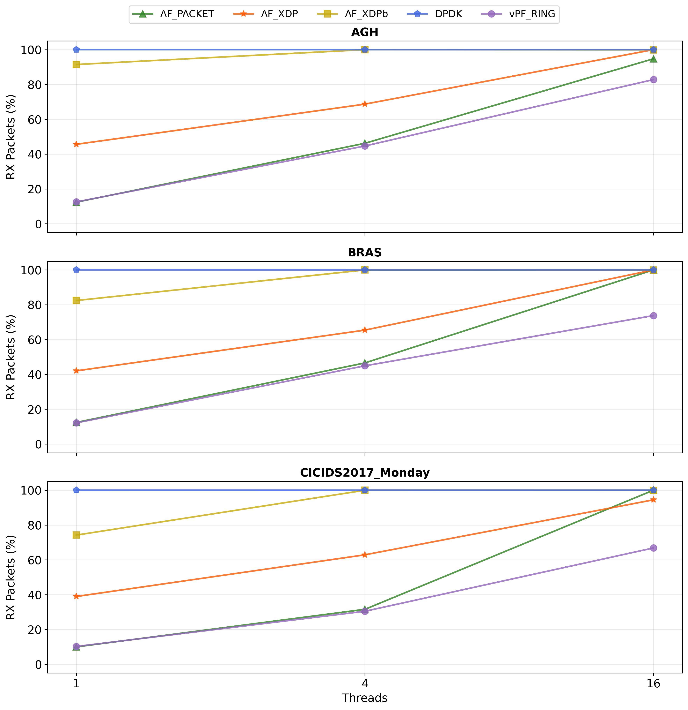
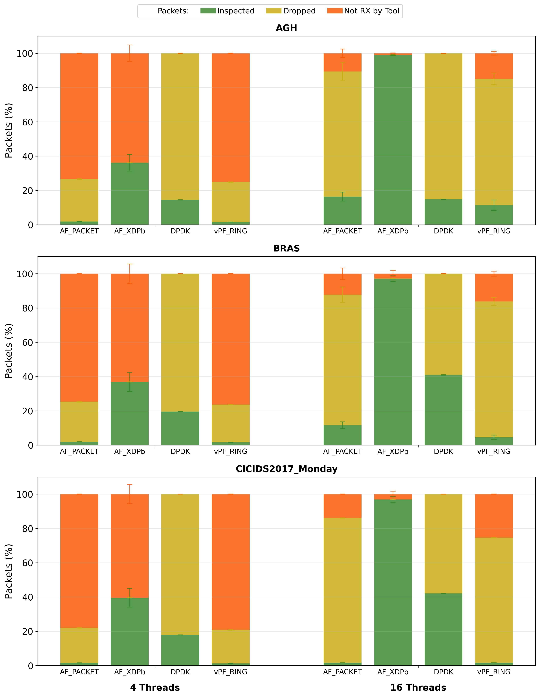

# Evaluating Packet Processing Frameworks

This repository contains an analysis of four different packet capture and processing frameworks: AF_PACKET, AF_XDP, DPDK, and (vanilla) PF_RING. We evaluated them using a simple packet-counting application (inside the `baseline/` folder) and when integrated with the Suricata NIDS. 

## Results and Outcomes

Our results show that DPDK has unmatched raw packet processing capabilities, presenting all packets to the user-space application across almost all scenarios. Figures 1 and 2 show these results under different link speeds, packet sizes, and flow profiles. 

*Figure 1: Single-threaded experiments with varying speeds and packet sizes.*

*Figure 2: Multi-threaded experiments with flow profiles.*

However, when integrated with Suricata, DPDK's raw packet capture performance did not translate into application-level efficiency, as shown in Figure 3. Despite capturing all packets, Suricata with DPDK failed to inspect a significant amount of them, even when increasing the *mempool* parameters or the *rx-descriptors*. This indicates that the issue stems from how DPDK's raw packets are converted into data structures that Suricata can analyze, as well as how DPDK's internal structures are managed. 

Conversely, AF_XDP with busy-polling did not present all packets to Suricata, but (with enough threads) Suricata managed to inspect almost all the packets trasmitted, analyzing more than 95% of all traffic in our evaluation.

*Figure 3: Suricata experiments with different threads and flow length distribution profiles.*

For more information on the evaluated frameworks and the experiment setup, read the [full report](Evaluating_Packet_Processing_Frameworks.pdf).

## Reproducing this research

This section briefly details the steps needed to reproduce this research. 

### Setup

We used two machines: one running the simple application or [Suricata](https://suricata.io/), and the other running [TRex](https://trex-tgn.cisco.com/) to generate the experiment's traffic. 

### Device under test

For the device under test, ensure that all the above-mentioned tools exist, and proceed to install Suricata from the source code, enabling DPDK and PF_RING during configuration (i.e., `./configure --enable-dpdk -enable-pfring`). 

### Traffic generation machine

On the traffic generation machine, install TRex and configure the folders as follows. On the home directory (i.e. `~/`), create a `packet_capture/` folder and two subfolders named `stl/` and `out/`. In the `stl/` folder, put all the contents of the `trex/` folder of this repo into it. That's it. These configuration steps ensure that the evaluation scripts work out-of-the-box. If you have a different setup (or want to have), update the evaluation scripts in the `scripts/` folder accordingly. 

### Evaluation scripts

There are three main scripts: `configuration_eval` for the results in Figure 1, `baseline_programs` for the results in Figure 2, and `suricata_eval` for the results in Figure 3. Remember to update the TRex machine-related information, such as **user and IP**, in each script.

With all these steps taken, you can reproduce the results obtained in this GitHub repository.